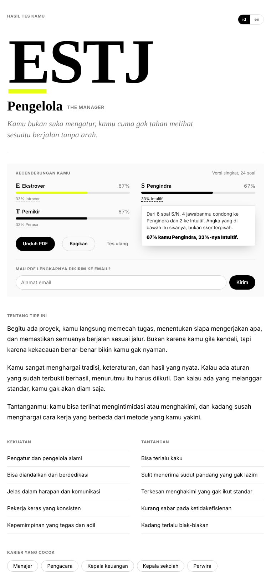

# Owrite Quiz

*Bahasa Indonesia · [English](README.md)*

Plugin WordPress untuk tes kepribadian 16 tipe. Awalnya dibuat buat [owrite.id](https://www.owrite.id), sekarang dibuka supaya bisa dipakai siapa saja.

Satu shortcode, `[owrite_mbti]`, dan halamanmu punya tes yang jalan dari awal sampai hasil tanpa pembaca perlu daftar atau ninggalin email. Dua bahasa (Indonesia dan English, bisa ganti kapan saja di tengah tes), dua versi (60 soal atau 24 soal), progres tersimpan kalau halaman ke-refresh, hasil langsung muncul di halaman yang sama: kode empat huruf, nama tipe, kecenderungan per dimensi, penjelasan, kekuatan, tantangan, dan karier yang cocok. Pembaca bisa unduh PDF-nya, atau minta dikirim ke email kalau mau.

Di sisi admin ada rekap: berapa respons masuk, tipe apa yang paling sering muncul, siapa yang minta PDF, dan ekspor CSV.



## Pasang

Unduh repo ini sebagai zip, unggah lewat Plugin → Tambah Baru → Unggah Plugin, aktifkan. Lalu taruh `[owrite_mbti]` di halaman mana pun. Menu **Owrite Quiz** muncul di sidebar admin untuk rekapnya.

Tampilannya sengaja netral dan ikut warna tema (terang atau gelap mengikuti sistem), pakai font tema untuk teks dan font serif untuk judul. Kalau tema kamu memuat Crimson Pro dan Inter, dua font itu yang dipakai; kalau tidak, jatuh ke Georgia dan font sistem.

## Isi repo

```
owrite-quiz.php        menu admin, rekap, shortcode, endpoint AJAX, schema
assets/mbti-data.js    60 soal dan 16 tipe, dua bahasa
assets/mbti.js         alur tes dan halaman hasil
assets/mbti-pdf.js     pembuat PDF di sisi browser (jsPDF)
assets/mbti.css        gaya, termasuk mode gelap
```

Soal dan deskripsi tipe sengaja dipisah ke `mbti-data.js` supaya gampang diubah tanpa menyentuh logika. Tiap soal punya `kutubA` dan `kutubB`; jawaban A menambah satu poin ke kutub A, B ke kutub B. Huruf yang menang per pasangan jadi kode tipenya, kalau seri jatuh ke huruf pertama (E, S, T, J), dan halaman hasil bilang terus terang kalau itu terjadi.

## Soal MBTI

MBTI itu alat refleksi, bukan diagnosis, dan "MBTI" adalah merek dagang The Myers-Briggs Company. Plugin ini memakai istilah itu sebagai nama umum untuk kerangka 16 tipe; soal dan deskripsinya ditulis sendiri, tidak diambil dari instrumen resmi mana pun.

## Versi Next.js

Di owrite.id sendiri tes ini sudah dipindah ke Next.js dengan halaman statis per tipe. Yang di repo ini versi WordPress-nya, dirapikan supaya bisa berdiri sendiri. Lihat jalannya di [owrite.id/quiz/mbti-test](https://www.owrite.id/quiz/mbti-test/).

## Lisensi

GPL-2.0-or-later. Dibuat oleh [Hafidz Nc](https://aconymous.com) (Aconymous).
